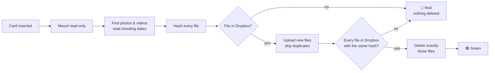
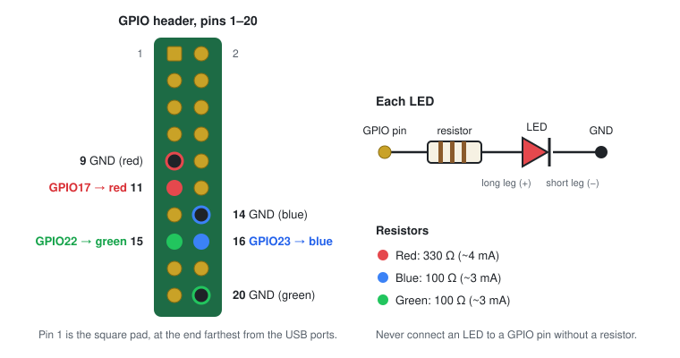

<h1 align="center">Pi SD Uploader for Dropbox</h1>

<p align="center">
  <strong>Put a camera card in. Take it out when the light is green.</strong><br>
  A Raspberry Pi that uploads camera SD cards to Dropbox, verifies every file, and only then clears the card.
</p>

<p align="center">
  <a href="https://github.com/shadeisroot/Pi-sd-uploader-dropbox/actions/workflows/ci.yml"></a>
  <a href="LICENSE"></a>
  
  
</p>

---

No computer, no app, no buttons. Plug a card reader into a Raspberry Pi, and every card you put in is backed up to Dropbox, sorted into folders by the date each photo was taken. A status light tells you when it's safe to take the card out. The card comes back empty and ready for the camera, but **only the files that were checked in Dropbox are ever deleted.**

Good for a family member who takes lots of photos and never backs them up, a holiday home, or your own desk.

| 🔵 Blue, blinking | 🟢 Green | 🔴 Red, blinking fast | Off |
|---|---|---|---|
| Working: leave the card in | Done: safe to take out | Something went wrong: **nothing was deleted** | Waiting for a card |

## Features

- **Automatic.** Starts when a card is inserted, including a card that's already in when the Pi boots.
- **Sorted by shooting date.** `2026/07/IMG_0412.JPG`, using EXIF dates (photos and RAW), video creation dates, or the file date as a last resort. The folder layout is configurable.
- **Verified, not assumed.** Every file is hashed on the Pi with Dropbox's own content hash and compared with what Dropbox stored. A card is only "done" when every single file matches.
- **Deletes only what it verified.** Exactly the files from this run's verified list. Folders, camera index files and anything else on the card are left alone. Starts in dry-run mode.
- **Never overwrites.** Files already in Dropbox are skipped; a different file with the same name is uploaded as `IMG_0001_2.JPG`.
- **Fails safe.** Dropbox full, no internet, card pulled out, power cut: the light turns red and nothing is deleted. Put the card back in and it picks up where it left off.
- **Restricted Dropbox access.** Recommended setup uses a Dropbox *App folder*: the Pi can only see its own folder, never the rest of your Dropbox.
- **FAT32 and exFAT**, photos and video: JPEG, HEIC, PNG, TIFF, DNG, CR2/CR3, NEF, ARW, ORF, RW2, RAF, MOV, MP4, MTS and more.
- **Tested.** An end-to-end test runs a fake camera card through upload, verify and delete on every commit.

**Speed:** on a Raspberry Pi 3 B with Ethernet, a 4.9 GB card (199 RAW photos) took 11½ minutes from insert to green. A long, throttled 6-hour upload was also tested, to make sure big cards survive Dropbox login renewals.

## How it works



A udev rule notices the card and starts a systemd service, which runs the uploader with [rclone](https://rclone.org) and [ExifTool](https://exiftool.org). The full walk-through, including the safety checks before anything is deleted, is in **[docs/how-it-works.md](docs/how-it-works.md)**.

## What you need

| | Part | Notes |
|---|---|---|
| 🍓 | **Raspberry Pi** | Built and tested on a **Pi 3 Model B**. A Pi 4 or 5 should work the same. |
| 💾 | **microSD card** for the Pi, 8 GB+ | For the Pi's own system, not the camera card. |
| 🔌 | **Power supply** | The official one for your Pi model (Pi 3: 5 V 2.5 A micro-USB). |
| 🃏 | **USB SD card reader** | Any USB reader. Tested with a Genesys Logic `05e3:0764` based reader. |
| 🌐 | **Network** | Ethernet recommended; Wi-Fi works too. |
| 💡 | **3 LEDs + resistors** *(optional)* | Red, blue, green 5 mm LEDs, 330 Ω for red, 100 Ω for blue and green, and 6 female jumper wires. Or use the Pi's own LED, or no light. |
| 📦 | **Case** *(optional)* | A clear case lets the LEDs show through. |
| ☁️ | **Dropbox account** | Any plan. |

Details, wiring and resistor maths: **[docs/hardware.md](docs/hardware.md)**.

## Installation

About 30 minutes, most of it waiting for downloads.

### 1. Set up the Pi

1. Install **[Raspberry Pi Imager](https://www.raspberrypi.com/software/)** on your computer.
2. Choose your Pi model, **Raspberry Pi OS Lite (64-bit)**, and the Pi's microSD card.
3. Click **Edit settings**: set a hostname (e.g. `sdpi`), a username and password, your time zone, Wi-Fi if you're not using Ethernet, and on the *Services* tab **enable SSH**.
4. Write the card, put it in the Pi, connect the network and power it on.
5. After a couple of minutes, log in from your computer:
   ```bash
   ssh <username>@sdpi.local
   ```

### 2. Wire the LEDs *(optional)*

Shut the Pi down first (`sudo poweroff`, then unplug it). Each LED goes from a GPIO pin, through its resistor, to a ground pin:

<p align="center"></p>

| LED | Long leg (+) → resistor → | Short leg (−) → |
|---|---|---|
| 🔴 Red | pin 11 (GPIO17), 330 Ω | pin 9 (GND) |
| 🔵 Blue | pin 16 (GPIO23), 100 Ω | pin 14 (GND) |
| 🟢 Green | pin 15 (GPIO22), 100 Ω | pin 20 (GND) |

Other pins work too; set them in the config file. No LEDs? Set `LED_BACKEND=act` to use the Pi's own green LED, or `none`.

### 3. Install

On the Pi:

```bash
sudo apt install -y git
git clone https://github.com/shadeisroot/Pi-sd-uploader-dropbox.git
cd Pi-sd-uploader-dropbox
sudo ./install.sh
```

The installer adds the packages it needs (ExifTool, rclone, exFAT tools, gpiozero), installs the `sd-uploader` command, and starts the status light. It's safe to run again; that's also how you update. There's deliberately no `curl | sudo bash`: you can read [`install.sh`](install.sh) before running it.

### 4. Connect Dropbox and test the light

```bash
sudo sd-uploader setup
```

Setup asks how the Pi should get into Dropbox:

- **App folder (recommended):** the Pi can only see `Dropbox/Apps/<your app name>/`. You create a free Dropbox app once (setup shows each click); takes about 5 minutes.
- **Quick:** no app needed, but the Pi gets access to your whole Dropbox. Photos go to `Dropbox/SD Uploader/`.

The Pi has no browser, so the login runs on your computer: setup prints one `rclone authorize …` command for you to run there ([install rclone](https://rclone.org/install/) on that computer first), and you paste the result back. Then it flashes blue, green and red so you can check the wiring.

### 5. Try it, then switch on deleting

Put a camera card in the reader. The light blinks **blue** while it works and turns **green** when every file is uploaded and verified. Check what happened:

```bash
sudo sd-uploader status      # settings, Dropbox connection, last result
sudo sd-uploader logs        # the full log of the last card
```

Out of the box, nothing is deleted: the log ends with *"would delete these N files"*. When you're happy with a few runs, switch deleting on:

```bash
sudo sed -i 's/^DELETE=.*/DELETE=on/' /etc/sd-uploader/sd-uploader.conf
```

From the next card on, the verified photos and videos are removed from the card before the light turns green.

## Everyday use

1. Put the card in.
2. Wait for **green** (a few minutes for a typical card).
3. Take it out. It's empty and ready for the camera.

If it's **red**, nothing was deleted. Take the card out and put it back in to try again; files already in Dropbox are skipped. `sudo sd-uploader logs` says what went wrong.

| Command | What it does |
|---|---|
| `sudo sd-uploader status` | Settings, light, Dropbox connection and free space, card, last result |
| `sudo sd-uploader logs` | The last card's log. `logs -f` follows live |
| `sudo sd-uploader run --dry-run` | Show what would be uploaded, without changing anything |
| `sudo sd-uploader run` | Run by hand on the card in the reader |
| `sudo sd-uploader test-leds` | Blue, green, red in turn |
| `sudo sd-uploader connect` | Reconnect Dropbox |

## Configuration

Settings live in **`/etc/sd-uploader/sd-uploader.conf`** and apply to the next card.

| Setting | Default | Meaning |
|---|---|---|
| `REMOTE` | `dropbox:` | Where to upload. Add a folder: `"dropbox:Camera"` |
| `FOLDER_FORMAT` | `%Y/%m` | Folders from the shooting date: `%Y` year, `%m` month, `%d` day. E.g. `%Y/%Y-%m-%d` |
| `DELETE` | `dry-run` | `dry-run` only lists, `on` deletes verified files, `off` leaves the card alone |
| `MIN_FREE_GB` | `1` | Dropbox space to keep free. If a card doesn't fit, nothing is uploaded |
| `TRANSFERS` | `4` | Files uploaded at once |
| `LED_BACKEND` | `gpio` | `gpio` (3 LEDs), `act` (the Pi's onboard LED), `none` |
| `LED_PIN_RED` / `_BLUE` / `_GREEN` | `17` / `23` / `22` | BCM GPIO numbers. After changing: `sudo systemctl restart sd-uploader-status` |

## Safety

Deleting photos is the one thing this project must never get wrong, so it's built around that:

- The card is mounted **read-only** while it's read, hashed and uploaded.
- Uploads use rclone's `--immutable`: an existing Dropbox file is never changed.
- The delete list is **this run's manifest**: files that were just hashed on the card and found in Dropbox with the **same hash**. Nothing else.
- Right before deleting, it checks the card is **the same card** (filesystem UUID) and that **no file has changed size or time** since it was hashed. Any difference: red, nothing deleted.
- The card is switched to read-write only for the deletes, then synced and switched back. Green comes only after that, so pulling the card on green is always safe.
- Every run writes a log, a manifest (card path → Dropbox path → hash) and a list of deleted files to `/var/log/sd-uploader/`, kept for 180 days.

## Troubleshooting

| Problem | Try |
|---|---|
| Nothing happens when a card goes in | `sudo sd-uploader status`, then `sudo sd-uploader logs -f` while you insert the card |
| Red: *can't reach Dropbox* | Check the network; `sudo sd-uploader status` shows whether Dropbox answers |
| Red: *Dropbox is full* | Free up space, then reinsert the card |
| No light at all | `sudo sd-uploader test-leds`; check the long/short legs and the pins |
| Dropbox access expired or revoked | `sudo sd-uploader connect` |

More in **[docs/troubleshooting.md](docs/troubleshooting.md)**. Want to reach the Pi when it lives at someone else's house? See **[docs/remote-access.md](docs/remote-access.md)**.

## Updating and uninstalling

```bash
cd Pi-sd-uploader-dropbox && git pull && sudo ./install.sh   # update: keeps settings and login
sudo ./uninstall.sh            # remove; keeps settings, Dropbox login and logs
sudo ./uninstall.sh --purge    # remove those too
```

Nothing in Dropbox is ever touched by uninstalling.

## Project layout

```
├── install.sh / uninstall.sh
├── config/sd-uploader.conf     default settings
├── src/
│   ├── sd-uploader             the command (setup, status, logs, run, …)
│   ├── offload.sh              upload → verify → delete
│   ├── statusd.py              status light daemon (gpiozero)
│   ├── card-removed.sh         reacts to a card being pulled out
│   └── connect-dropbox.sh      guided Dropbox login
├── systemd/  udev/  system/    services, card trigger, logs and tmpfiles config
├── tests/e2e.sh                end-to-end test on FAT32 and exFAT images
└── docs/
```

## Development

The end-to-end test builds FAT32 and exFAT card images with awkward file names, a name clash, a duplicate and a file with no date. It runs the real uploader against a local folder standing in for Dropbox, and checks upload, verification, never-overwrite, dry-run and deletion. It needs root for the loop device:

```bash
sudo apt install -y libimage-exiftool-perl rclone dosfstools exfatprogs
sudo tests/e2e.sh
```

CI runs it, plus ShellCheck, on every push. Issues and pull requests are welcome.

## Limitations

- **Dropbox only.** Verification relies on Dropbox's content hash. rclone supports other clouds, but they'd need a different hash check.
- **No automatic retry** after a network outage: the light turns red, and reinserting the card resumes.
- **Video dates:** many cameras write video times in local time even though the standard says UTC, so a clip filmed just before midnight on the last day of a month can land in the next month's folder.

## Acknowledgements

Built on [rclone](https://rclone.org), [ExifTool](https://exiftool.org) by Phil Harvey, and [gpiozero](https://gpiozero.readthedocs.io).

## License

[MIT](LICENSE) © 2026 shadeisroot
