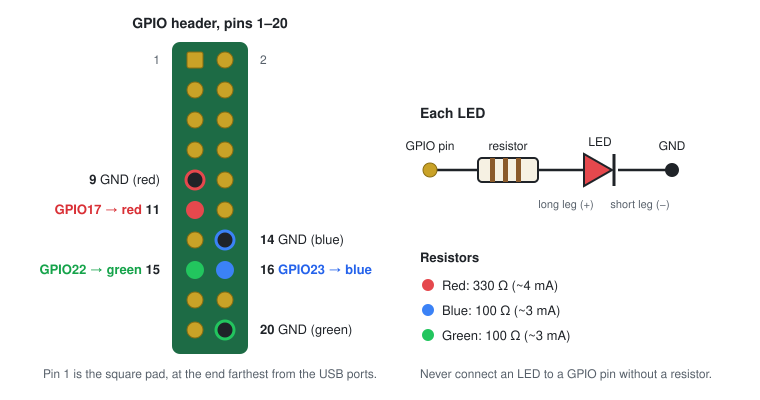

# Hardware

## Parts

| Part | Notes |
|---|---|
| **Raspberry Pi** | Built and tested on a **Raspberry Pi 3 Model B** with Raspberry Pi OS Lite 64-bit (Debian 13). Any Pi that runs Raspberry Pi OS and has a USB port should work. |
| **microSD card** for the Pi | 8 GB or more. This holds the Pi's system, not photos. |
| **Power supply** | The official supply for your model. An underpowered Pi can drop the card reader. Check with `vcgencmd get_throttled`: it should print `throttled=0x0`. |
| **USB SD card reader** | Any USB mass-storage reader. USB 3 readers work in a Pi 3's USB 2 ports, at USB 2 speed. Tested: a Genesys Logic `05e3:0764` based reader with SD and NM slots. |
| **Network** | Ethernet is simplest and fastest. Wi-Fi works if it's set up in Raspberry Pi Imager. |
| **LEDs** *(optional)* | One red, one blue, one green, plain 5 mm. |
| **Resistors** *(optional)* | 330 Ω for red, 100 Ω for blue and green (¼ W). |
| **Jumper wires** *(optional)* | 6× female-to-female, or solder the resistors onto the LED legs and use female plugs. |
| **Case** *(optional)* | A clear case lets the LEDs show through. If it has a fan, it usually uses pins 4 and 6, which this wiring leaves free. |

## Which camera cards work

SD, SDHC and SDXC cards formatted by a camera: **FAT32** (cards up to 32 GB) and **exFAT** (larger cards). microSD works with an adapter or a reader with a microSD slot.

## Wiring the LEDs

<p align="center"></p>

| LED | Long leg (+) → resistor → | Short leg (−) → |
|---|---|---|
| 🔴 Red | pin 11 (GPIO17), 330 Ω | pin 9 (GND) |
| 🔵 Blue | pin 16 (GPIO23), 100 Ω | pin 14 (GND) |
| 🟢 Green | pin 15 (GPIO22), 100 Ω | pin 20 (GND) |

- **Always shut down and unplug the Pi before moving wires.**
- **Never connect an LED to a GPIO pin without a resistor.** A Pi pin can safely give about 16 mA; without a resistor an LED tries to draw much more.
- The resistor can go on either leg, as long as it's in series.
- If an LED stays dark, it's usually the wrong way round (long leg must go towards the GPIO pin) or on the wrong pin. Test one at a time with `sudo sd-uploader test-leds`.
- A case lid can push plugs off the pins when it's closed. Test again after closing the case.

### Why these resistor values

Current = (3.3 V − LED voltage) ÷ resistance. Aim for well under 10 mA:

| LED | LED voltage (approx.) | Resistor | Current |
|---|---|---|---|
| Red | 2.0 V | 330 Ω | ~4 mA |
| Blue | 3.0 V | 100 Ω | ~3 mA |
| Green (modern, bright) | 3.0 V | 100 Ω | ~3 mA |
| Green (old, yellowish) | 2.1 V | 330 Ω | ~4 mA |

Blue and green LEDs use up almost all of the 3.3 V, so the usual 330 Ω would make them very dim.

### Different pins

Any free GPIO pins work. Put the **BCM GPIO numbers** (not the physical pin numbers) in `/etc/sd-uploader/sd-uploader.conf`, then:

```bash
sudo systemctl restart sd-uploader-status
sudo sd-uploader test-leds
```

Pin map: [pinout.xyz](https://pinout.xyz).

### No LEDs

- `LED_BACKEND=act`: uses the Pi's green activity LED. Slow blink = working, solid = done, fast blink = error.
- `LED_BACKEND=none`: no light; check with `sudo sd-uploader status`.

## Optional: switch off the Pi's own LEDs

If the onboard red and green LEDs are distracting next to the status LEDs (and you use `LED_BACKEND=gpio`), add this to `/boot/firmware/config.txt` and reboot:

```ini
[all]
dtparam=act_led_trigger=none
dtparam=act_led_activelow=off
dtparam=pwr_led_trigger=none
dtparam=pwr_led_activelow=off
```

Without the power LED, you can't see when the Pi has finished shutting down. Wait about 15 seconds after `sudo poweroff`, or check that it no longer answers `ping`.
